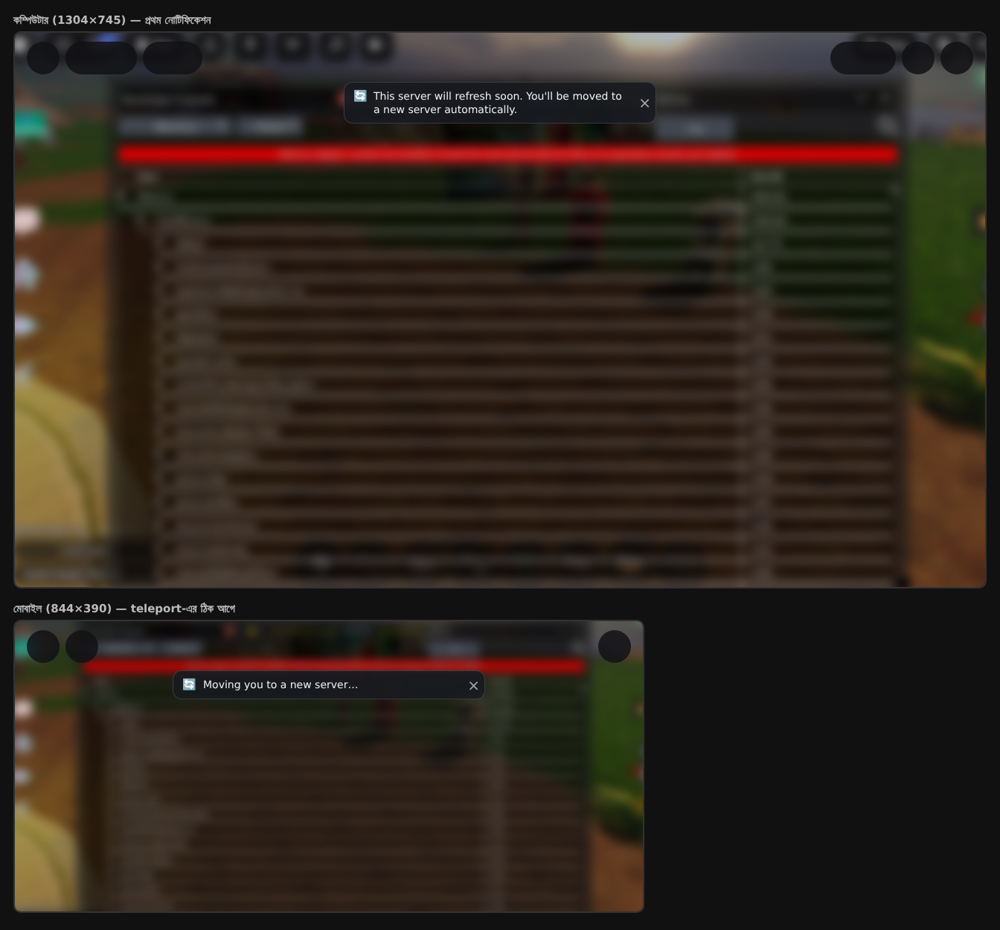

# ServerRecycler: ১২ ঘণ্টা পর সার্ভার রিফ্রেশ

সার্ভার ১২ ঘণ্টা (+ random ০–৩০ মিনিট) পুরনো হলে প্লেয়ারদের ধাপে ধাপে একটা নতুন সার্ভারে পাঠিয়ে দেয়। সার্ভার খালি হলে Roblox নিজেই সেটা বন্ধ করে। মেমোরি দেখে না, শুধু সময় দেখে।

| ফাইল | কোথায় রাখবেন | ধরন |
| --- | --- | --- |
| `ServerRecycler.server.lua` | ServerScriptService | Script |
| `ServerRecycleNotice.client.lua` | StarterPlayer → StarterPlayerScripts | LocalScript |

আগের MemoryGuard স্ক্রিপ্টটা মুছে দিন বা Disabled করুন।

## কীভাবে কাজ করে

1. খালি করা শুরুর ৫ মিনিট আগে উপরে ছোট একটা নোটিফিকেশন দেখায়।
2. সময় হলে শুধু **TARGET_MAX_HOURS (৪ ঘণ্টা)-এর কম বয়সী** সার্ভার খোঁজে, সবচেয়ে নতুনটা আগে।
   এমন সার্ভার না থাকলে পাঠায় না, নতুন সার্ভার খোলার জন্য অপেক্ষা করে (প্রতি ১৫ সেকেন্ডে আবার দেখে)।
3. ধাপে ধাপে পাঠায়:

   | সার্ভারে বাকি প্লেয়ার | প্রতিবারে | বিরতি |
   | --- | --- | --- |
   | ২০-এর বেশি | ৩ জন | ১২ সেকেন্ড |
   | ১১–২০ | ৪ জন | ১০ সেকেন্ড |
   | ৬–১০ | ৫ জন | ৮ সেকেন্ড |
   | ৫ বা কম | বাকি সবাই | — |

4. নতুন আসা প্লেয়ারকে অন্তত ৩০ সেকেন্ড আর ডেটা লোড হওয়া পর্যন্ত সময় দেয়।
5. প্রতিবার পাঠানোর আগে DataStore budget দেখে নেয়, কম থাকলে কম প্লেয়ার পাঠায়।
6. ৪৫ মিনিট অপেক্ষার পরেও কোনো নতুন সার্ভার না পেলে একটা একদম নতুন reserved সার্ভারে পাঠায় (`USE_RESERVED_FALLBACK`)।
7. কারো teleport ৪ বার ব্যর্থ হলে তাকে "আবার join করুন" মেসেজ দিয়ে kick করে, যাতে সার্ভারটা বন্ধ হতে পারে।

## একটা লাইন যোগ করুন (ডেটা লোড)

আপনার ডেটা স্ক্রিপ্টে প্রোফাইল লোড হওয়ার ঠিক পরে:

```lua
player:SetAttribute("DataLoaded", true)
```

এটা না দিলেও কাজ করবে, তবে তখন প্রতিটা নতুন প্লেয়ারকে পুরো ৩ মিনিট (`MAX_WAIT_AFTER_JOIN`) অপেক্ষা করানো হবে।

## নোটিফিকেশন



ছবিটা একটা আনুমানিক মকআপ। আসল চেহারা দেখতে Studio-তে **Play** চাপুন: ৩ সেকেন্ড পর প্রথম নোটিফিকেশন আর ১৪ সেকেন্ড পর "Moving you…" দেখাবে (Studio-তে teleport হয় না)।

- **পুরো নোটিফিকেশন বন্ধ:** `ServerRecycler`-এ `SHOW_NOTICE = false`
- **শুধু Studio প্রিভিউ বন্ধ:** `PREVIEW_NOTICE_IN_STUDIO = false`
- **লেখা বদলাতে:** `NOTICE_SOON` আর `NOTICE_MOVING`
- **কতক্ষণ থাকবে:** `ServerRecycleNotice`-এ `SHOW_SECONDS` (এখন ৮ সেকেন্ড)। প্লেয়ার × চাপলে আগেই বন্ধ হয়।

## টেস্ট করবেন যেভাবে

1. একটা আলাদা **টেস্ট place**-এ (আসল গেমে না) দুটো স্ক্রিপ্ট রাখুন, আর `TEST_MODE = true` করুন। এতে ৬ মিনিটেই খালি করা শুরু হয়, আর ২ মিনিট নতুন সার্ভার না পেলে reserved সার্ভারে পাঠায়।
2. Publish করে দুটো আলাদা সার্ভারে join করুন (দুটো অ্যাকাউন্ট, বা একটা সার্ভার পূর্ণ হলে)।
3. Output/Developer Console-এ `[ServerRecycler]` লেখা খুঁজুন।
4. টেস্ট শেষে অবশ্যই `TEST_MODE = false` করুন।
